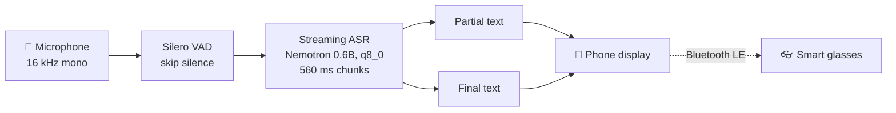

# Helica

**HE**brew **LI**ve **CA**ptioning: real-time Hebrew captions for deaf and hard-of-hearing users, powered by edge AI on smartphones and smart glasses.

> 🚧 **Status: early research phase.** On-device feasibility is proven on a mid-range phone. Hebrew fine-tuning is next.

---

## Problem statement

Deaf and hard-of-hearing people need captions for everyday conversations, not just videos.
Existing live-caption tools for Hebrew either depend on the cloud, which brings latency, privacy issues, and no offline use, or have weak Hebrew accuracy.

## Goals

- **Fully on-device.** No audio leaves the phone.
- **Low latency.** Text appears while the person is still speaking.
- **Runs on mid-range phones**, not just flagships.
- **Smart glasses as a display.** The phone does the transcription; the glasses show the text.

---

## Architecture

| | Plan A (primary) | Plan B (fallback) |
|---|---|---|
| Model | NVIDIA Nemotron 3.5 ASR Streaming 0.6B | Whisper `base` |
| Runtime | NeMo-Speech.cpp (ggml, GGUF `q8_0`) | whisper.cpp (GGML `q8_0`) |

---

## Results so far

Phone tests ran on a mid-range **Poco X4 Pro 5G (Snapdragon 695)**, CPU only.

| | Nemotron 0.6B (streaming) | Whisper `base` |
|---|---|---|
| Speed, cool phone (RTF, lower is better) | ~0.43 | ~0.74 s per update |
| Speed, hot phone after several minutes | ~0.59 avg, stable | ~1.23 s per update, stable |
| Invented text on silence and noise (no VAD) | ✅ None on all 4 clips | ❌ On all 4 clips |
| Battery, non-stop speech | ~17% per hour | ~15–20% per hour |
| Hebrew error rate, eval-d1 (before fine-tuning) | 0.171 | — |

**Takeaways:** Nemotron runs live on a mid-range phone and never invented text from silence or noise, so it was chosen as the primary engine. Its Hebrew accuracy is the gap to close: the target is an error rate of ≤ ~0.12 on eval-d1 (an ivrit.ai test set) after the pilot fine-tune.
Whisper re-processes a growing audio buffer on every update. Nemotron processes each audio chunk once. That's cheaper, steadier, and avoids flickering text.

---

## Roadmap

- [x] **Phase 0:** Nemotron and Whisper phone tests (speed, heat, battery, hallucinations, VAD)
- [ ] **Phase 1:** Training setup on a local PC (Fedora, RTX 5060 Ti 16 GB), evaluation harness, baseline
- [ ] **Phase 2:** Nemotron Hebrew fine-tuning pilot (100–200 hours of audio)
- [ ] **Phase 3:** Android prototype + testing with deaf users
- [ ] **Phase 4:** Scale-up training, quantization-aware training (int8)
- [ ] **Phase 5:** Mobile NPU deployment and smart-glasses display

---

## Acknowledgements

- [NVIDIA Nemotron 3.5 ASR](https://huggingface.co/nvidia/nemotron-3.5-asr-streaming-0.6b) and [NeMo-Speech.cpp](https://github.com/NVIDIA/NeMo-Speech.cpp)
- [ivrit.ai](https://huggingface.co/ivrit-ai) for Hebrew datasets, models, and the Hebrew ASR leaderboard

Model and dataset licenses apply: Nemotron is released under [OpenMDW-1.1](https://openmdw.ai/license/1-1/); ivrit.ai datasets have their own terms.
