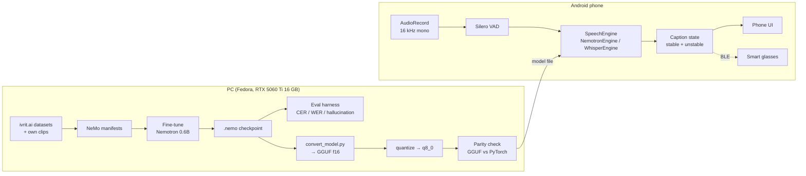
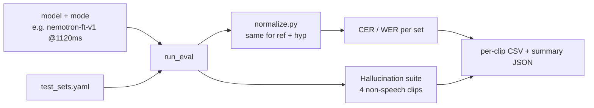
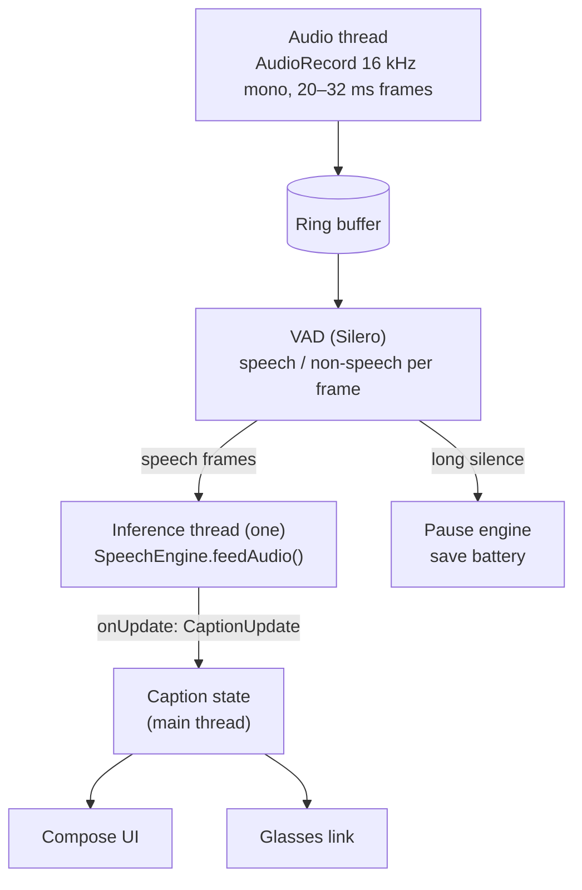

# Helica Architecture

*Last updated: October 26, 2026 (review: leakage guard, memory budget, caption events, VAD audio kept after speech) · Matches plan v3 (Nemotron = Plan A, Whisper = Plan B)*

Helica has three pipelines that share one set of models and one evaluation harness:

1. **Training pipeline** (PC, Fedora, RTX 5060 Ti 16 GB): Hebrew data → fine-tuned NeMo model.
2. **Export pipeline** (PC): NeMo checkpoint → GGUF → quantized `q8_0` → parity-checked against PyTorch.
3. **On-device runtime** (Android phone): microphone → VAD → streaming ASR → caption state → display (phone, later glasses).



---

## 1. Training pipeline

### 1.1 Data

| Source | Use | Notes |
|---|---|---|
| ivrit.ai datasets (Hugging Face) | Pilot: 100–200 h; later: scale up | Check each dataset's license; record it in `DECISIONS.md` |
| Pseudo-labeled audio | Phase 4 | Teacher: `ivrit-ai/whisper-large-v3-turbo-ct2-20250513` |
| English + code-switched | 10–20 % of the mix | Keeps English ability; handles "deadline", "report" etc. |
| Far-field (2–3 m) recordings | Phase 4 | Distant speech produced fluent wrong text with Whisper |

**Leakage guard:** both data scripts read `exclude_sources` from `eval/test_sets.yaml` (entries are id prefixes).
- **Pilot:** `training/scripts/select_crowd_v5.py` drops any clip whose uuid starts with an entry. It refuses to run while the list is empty or holds a TODO.
- **Scale-up draft:** `training/scripts/build_manifests.py` skips any sample whose id or `--source-col` value starts with an entry. It refuses to run while the list holds a TODO, or when the list is set but `--source-col` isn't, because then it would compare only row ids and exclude nothing.

The guard is only as good as the list:
- list the whole eval-d1 **podcast series** (same hosts and topics), not just the episode
- also check eval transcripts against training text for duplicates

**Sampling:**
- **Pilot:** the whole filtered crowd-transcribe-v5 train split (D-022). Validation is its `test` split, which shares no episode with train (D-021).
- **Scale-up (`build_manifests.py`):** rows are shuffled (`--seed`) and capped per source (`--max-hours-per-source`), so a run isn't the first N hours of a few podcasts. Validation is held out **by episode** (`--val-frac`, stable hash of the source id).

**Manifest format** (NeMo, JSON lines, 16 kHz mono WAV/FLAC):
```json
{"audio_filepath": "/data/helica/audio/abc.flac", "duration": 7.42, "text": "שלום, מה שלומך?", "lang": "he-IL"}
```

**Text conventions** must be fixed *before* training (open decision): punctuation style, English words (Latin vs Hebrew letters), numbers (digits vs words). Training text and reference text must follow the same convention, or CER will measure the convention, not the model.

### 1.2 Fine-tuning

- Base: `nvidia/nemotron-3.5-asr-streaming-0.6b`, Hebrew already in the tokenizer (no tokenizer swap).
- Follow NVIDIA's guide "How to Fine-Tune Nemotron 3.5 ASR for Your Language, Domain, or Accent".
- **16 GB budget:** a full fine-tune with AdamW needs ~16 bytes per parameter:
  - fp32 weights 2.4 GB + gradients 2.4 GB + Adam states 4.8 GB ≈ **9.6 GB**
  - plus ~1 GB CUDA context
  - leaves ~5 GB for activations and the RNNT joint tensor (batch × frames × tokens × vocab), which is what usually runs out of memory

  So:
  - bf16 mixed precision
  - **fused joint/loss** (NeMo `fuse_loss_wer` + `fused_batch_size`; verify key names)
  - small batch (start 4) + gradient accumulation
  - cap sample duration (start ~15–20 s), bucket by duration
  - activation checkpointing (likely needed)
  - if still tight: 8-bit AdamW (saves ~3.6 GB) or freeze the lower encoder layers

  A 200-step smoke run measures peak memory and speed before any long run.
- Train with the **same streaming config** used on the phone (cache-aware, chunked attention), so the model is optimized for the inference mode it will actually run in. Keep the base model's **full list of `att_context_size` values** (multi-lookahead training), or chunk sizes not trained at will get worse. Evaluate at several chunk sizes; pick checkpoints by streaming WER at 1120 ms on the episode-held-out validation set.
- Every run writes to `runs/<date>_<name>/`: config, logs, checkpoints (gitignored), and an eval summary that gets copied into `docs/results/`.

### 1.3 Evaluation (gate for every model)



- **Test sets:**
  - leaderboard: ivrit.ai eval-d1, eval-whatsapp, SASpeech, FLEURS-he, Common Voice 17 he, Kan
  - own clips: clean, noisy, 2.5 m, code-switching
  - **real-world set:** 30–60 min of realistic conversations, hand-transcribed
- Normalization follows the ivrit.ai leaderboard code (`evaluate_model.py` in `ivrit-ai/asr-training`), so numbers are comparable with it. The leaderboard metric is **WER**; CER is always reported next to it. First check: reproduce Nemotron zero-shot eval-d1 ≈ 0.171 WER.
- **Hallucination suite** is a hard gate: any output on silence/noise, **even a lone punctuation mark** (checked on raw output, not normalized), = fail, regardless of accuracy.
  - It grows to 30–60 min of varied non-speech and reports characters per minute.
  - It runs at two levels: the model alone (no VAD) and the system with VAD, as in the app.
  - Insertions inside speech (text during pauses or after speech ends) are tracked on the speech sets.
- **Confidence check:** do low-confidence tokens line up with errors? If they do, the display can fade them (§3.3).
- Report per chunk size (160 / 320 / 560 / 1120 ms) → accuracy-vs-latency curve.

---

## 2. Export pipeline

```
.nemo  →  NeMo-Speech.cpp convert_model.py  →  GGUF (f16)  →  quantize  →  GGUF q8_0
                                                                    ↓
                                    parity check on PC CPU: same clips, NeMo PyTorch vs GGUF
                                                                    ↓
                                    phone check: same clips in Termux, compare text + RTF
```

- **Parity rule:** on ~200 eval utterances (not just the own clips: ~1 minute of audio is a handful of characters, so it's noise), same chunk size in streaming mode on both sides:
  - CER difference between PyTorch and GGUF `q8_0` < 0.5 points absolute
  - report the **exact-match rate** of the two outputs

  Bigger gaps → check conversion, then try q8_0 for sensitive layers only, then quantization-aware training (Phase 4).
- Hallucination suite reruns on the GGUF model too: quantization can change silence behavior.
- `q8_0` is the default **for now** (D-015): on the Snapdragon 695 (dotprod ✅, i8mm ❌) 8-bit was faster than 5-bit *for Whisper*. Nemotron at q4_0 hasn't been tested; ggml has fast q4_0 paths on ARM with dotprod, so measure speed and output text before deciding.

### Later: NPU path (Phase 5)

The RNNT has three parts: **encoder** (most of the compute), **prediction network** and **joint** (small, run per token). The NPU plan:
- Export the **encoder only** as a fixed-shape, per-chunk graph with the attention/conv **caches as explicit inputs and outputs** (static shapes are what NPU toolchains want).
- Keep prediction network + joint + greedy decoding on the CPU.
- Toolchain chosen with the target chip: Qualcomm QNN / AI Hub, MediaTek NeuroPilot, or LiteRT. INT8 needs calibration data → reuse the own-clips set + a slice of eval-free training audio.
- The Snapdragon 695 NPU is weak; NPU work needs a newer test phone.

---

## 3. On-device runtime (Android)

### 3.1 Components and threads



- **One inference thread**, 4 native threads inside NeMo-Speech.cpp (6 and 8 were slower: they land on the slow cores).
- **Model loaded once** at app start (~4 s), kept warm. Startup shows a "loading" state, not an empty screen.
- **VAD** gates audio before the engine. For Nemotron it's for battery (the model didn't hallucinate); for Whisper it's mandatory for correctness.
  - Keep ~300 ms of audio before speech starts, so word onsets aren't clipped.
  - Keep **~0.5–1 s of audio after speech ends** before pausing (D-013). Cutting silence out completely joins utterances together in the cache-aware model, and end-of-sentence punctuation may depend on the pause.
  - How much battery VAD saves in real conversations is unmeasured: with group talk or a TV on, VAD reports speech most of the time.
- **Backpressure:** if the inference thread falls behind (backlog > ~2 s of audio, e.g. thermal throttling), show a subtle "catching up" indicator; never silently drop speech. If it persists, switch 560 → 1120 ms chunks automatically.
- **Android lifecycle:** continuous capture runs in a **foreground service of type microphone**, with a battery-optimization exemption. Without them, Android limits background mic access and can kill long sessions. Keep the screen on only while captions are shown; screen-on heat and battery are part of Gate A′.
- **Memory:** model ~650 MB + runtime buffers; peak RAM must be measured (Gate A′). Phones with 4–6 GB RAM may kill the app.

### 3.2 The `SpeechEngine` interface

Both engines implement the same interface (`android/SpeechEngine.kt`), so the app, the evaluation of user experience, and the glasses link don't care which model runs.

```kotlin
interface SpeechEngine {
    fun feedAudio(samples: FloatArray)
    var onUpdate: (CaptionUpdate) -> Unit
}

data class CaptionUpdate(
    val segmentId: Long,        // one line on screen / one BLE diff
    val stableText: String,     // never changes once sent
    val unstableText: String,   // may change in the next update
    val words: List<Word>,      // text, startMs, endMs, confidence? (if the engine provides them)
    val segmentEnded: Boolean,
)
```

Structured events instead of plain strings, because the display and the tests need:
- **word confidence:** to fade low-confidence words
- **timestamps:** to measure end-to-end latency in Phase 3
- **segment ids:** for the glasses' BLE diffs

What the NeMo-Speech.cpp C ABI actually exposes (token timestamps? probabilities?) must be checked in the minimal Android app; until then `confidence` may be null.

| | `NemotronEngine` (Plan A) | `WhisperEngine` (Plan B) |
|---|---|---|
| Native lib | NeMo-Speech.cpp C ABI via JNI (fallback: sherpa-onnx, D-014) | whisper.cpp via JNI |
| Model | GGUF q8_0, ~650 MB | GGML base q8_0 |
| Streaming | Cache-aware, chunk 1120 ms (560 option) | Re-transcribe buffer since last commit, cap 6–8 s, `-ac 512` |
| Stable vs unstable | **Append-only:** cache-aware RNNT never revises emitted tokens. Everything is stable except the last incomplete word(piece). Segment ends at VAD end-of-utterance. | Last segment = unstable until it repeats N times or VAD pause |
| Must-have guards | Hallucination suite after every new model | VAD mandatory, repetition filter, drop segments past audio end, drop foreign scripts |
| Build note | Link `liblog` (`-llog`) | — |

### 3.3 Caption state and display

- Caption state = list of segments, each with **stable** text + an **unstable** tail. Stable text never changes; the unstable tail may. With Nemotron the tail is at most one incomplete word, so almost everything shows as final immediately (no flicker).
- Display: stable in normal weight; unstable grey/italic; reveal new words smoothly (no jumping text).
- **Right-to-left:** Hebrew mixed with English words and digits goes through the Unicode bidi algorithm. Appending a word can reorder the neighbouring Latin/digit runs, which makes text "jump". Test mixed lines early; isolate Latin/digit runs if needed. Check RTL support when choosing glasses too.
- **Fade low-confidence words:** the main defence against fluent-but-wrong text (e.g. distant speech), which a deaf user can't detect. It depends on the Phase 2 confidence check (does low confidence line up with errors?) and on the runtime exposing token probabilities.
- Distant/background speech: show / dim / hide → decided with testers.

### 3.4 Latency budget (Nemotron, estimates from Gate A numbers)

| Chunk | Wait for chunk | Compute (RTF 0.43–0.68) | ≈ Time to text (worst word in chunk) |
|---|---|---|---|
| 560 ms | 0.56 s | 0.24–0.38 s | **~0.8–0.95 s** |
| 1120 ms | 1.12 s | 0.48–0.76 s | **~1.6–1.9 s** |

Plus display animation (~0.1 s). Whisper Plan B: ~1.2–1.3 s per update when hot, plus commit delay. These are estimates; Phase 3 measures real end-to-end latency with word timestamps.

### 3.5 Smart glasses (Phase 5)

The phone does all transcription. The glasses only render text: phone sends caption updates over **Bluetooth LE** as small diffs (`{line_id, final: bool, text}`), so the glasses need no model and minimal battery.

---

## 4. Performance budget on the reference phone (Poco X4 Pro, Snapdragon 695)

| Resource | Measured (Nemotron q8_0) | Notes |
|---|---|---|
| Real-time factor | 0.43 cool → 0.59 avg / 0.68 worst hot | 1120 ms chunks, 4 threads, **English audio, screen off, 14 min**; re-test in Hebrew (Gate A′) |
| Battery | ~17 %/h non-stop speech, screen off | Screen on (as in the app) will be higher; with pauses + VAD lower. Measure both. |
| Startup | ~4 s | Once per app start |
| Model size | ~650 MB | Download on first run, not bundled in APK |
| Peak RAM | not measured | Gate A′ |

**Headroom levers** (in order of cost): bigger chunks → q4_0 quantization → thread count / affinity (2–3 threads on the fast cores) → VAD pausing → newer phones → NPU → distilled ~100–150M streaming student (a research project of its own; last).

---

## 5. Repo ↔ architecture map

| Architecture part | Code |
|---|---|
| Pilot clip selection, leakage guard | `training/scripts/select_crowd_v5.py` (Stage 2 manifest script: TODO) |
| Manifests for later datasets (scale-up draft) | `training/scripts/build_manifests.py` |
| Fine-tuning configs | `training/configs/` |
| Evaluation + normalization + hallucination suite | `eval/helica_eval/` |
| GGUF export, parity check | `export/` |
| Phone benchmarks | `phone-bench/` |
| App, `SpeechEngine` | `android/` |
